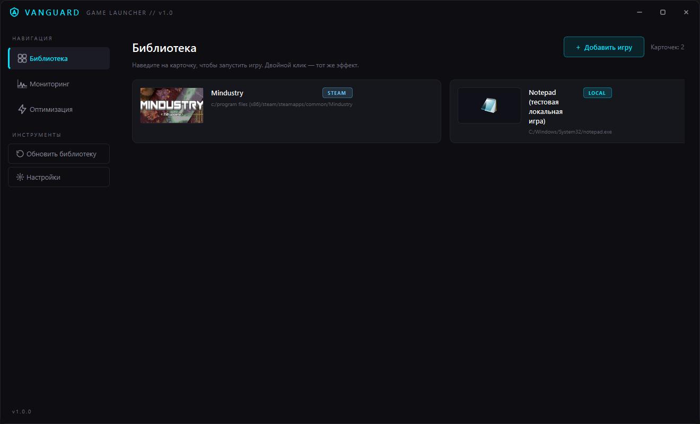
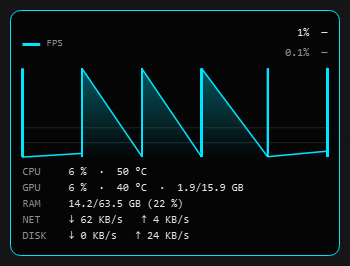
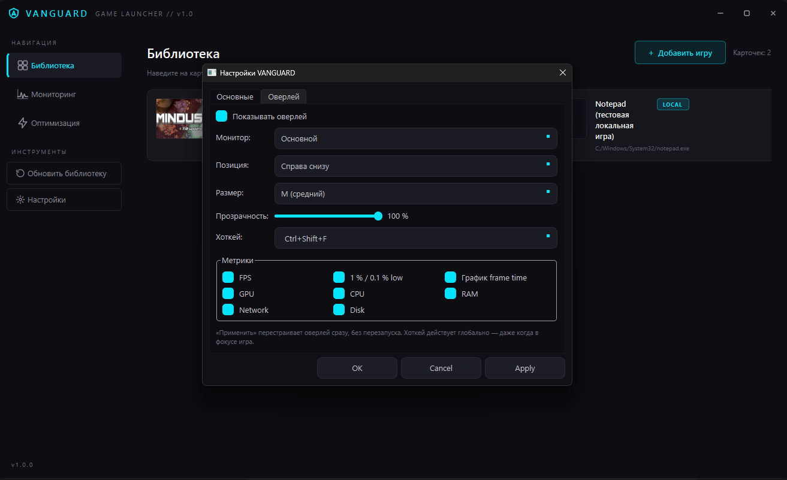

# VANGUARD Architecture (v1.0)

## Текущее состояние

v1.0.0: библиотека игр (Steam/Epic/Local), запуск, оптимизация с
восстановлением процессов, мониторинг FPS через PresentMon, системные
метрики (CPU/GPU-NVML/RAM/сеть/диск), FPS-оверлей поверх игр с глобальным
хоткеем и гибкими настройками, установщик Inno Setup.

## Скриншоты





## Модули

1. **GameScanner** — поиск игр Steam (appmanifest/`libraryfolders.vdf`),
   Epic (Manifests/*.item) и локальных (`local_games.json`), дедупликация.
2. **Optimizer** — закрытие/восстановление процессов, профили целей.
3. **FPSMonitor** — мониторинг FPS через Intel PresentMon (внешний процесс),
   батчи кадров, перцентили 1 % / 0.1 % low.
4. **MetricsProvider** — системные метрики: CPU (GetSystemTimes/PDH),
   GPU через NVML (динамическая загрузка nvml.dll), RAM, сеть (GetIfTable2),
   диск, температуры (async WMI).
5. **FpsOverlay** — отдельное topmost click-through окно поверх игр
   (WS_EX_LAYERED|TRANSPARENT|TOOLWINDOW|NOACTIVATE): 9 якорей, S/M/L,
   прозрачность, выбор монитора (в т.ч. зеркало на вторичном при «Оба»),
   гибкие метрики, профили на игру.
6. **SettingsManager** — JSON в `QStandardPaths::AppConfigLocation`.
7. **SettingsDialog** — QTabWidget: «Основные» (тема/PresentMon) и
   «Оверлей» (показ/монитор/позиция/размер/прозрачность/метрики/хоткей),
   кнопка «Применить» применяет настройки на лету.
8. **MainWindow** — frameless-окно: TitleBar, Sidebar, страницы
   `QStackedWidget` (Library / Monitor / Optimize), плавный fade-переход,
   глобальный хоткей (`RegisterHotKey` + `WM_HOTKEY` в `nativeEvent`).

## Схема взаимодействия

```
MainWindow (hwnd) <--- RegisterHotKey(Ctrl+Shift+F) --- WM_HOTKEY → FpsOverlay::toggle()
   |-- pages[0] Library
   |      |-- GameScanner.scanAll() --> games --> запуск (Steam URI / QProcess)
   |      |-- CoverCache (Steam CDN / иконка из exe)
   |-- pages[1] Monitor
   |      |-- FPSMonitor (QProcess → PresentMon.exe) --> fpsUpdated / percentilesUpdated / framesUpdated
   |      |-- MetricsProvider (500 мс) --> metricsUpdated
   |            |-- MonitorPage.setSystemMetrics(...)   (страница)
   |            \-- FpsOverlay.setSystemMetrics(...)    (оверлей, + mirror)
   |-- pages[2] Optimize
   |      |-- Optimizer.optimizeBeforeGame() / restoreAfterGame()
   |-- SettingsDialog --Apply/OK--> overlaySettingsApplied
            \-- FpsOverlay.loadSettings() + MainWindow::registerOverlayHotkey()
```

## Технологии и детали

- GameScanner: regex по `libraryfolders.vdf`, QJsonDocument по манифестам Epic,
  `local_games.json` (4 кандидата пути), case-insensitive дедупликация Steam.
- Optimizer: `taskkill /IM`, PowerShell `Get-Process` для пути к exe,
  `QProcess::startDetached` для восстановления.
- PresentMon: `--output_stdout --no_console_stats --session_name VANGUARD
  --stop_existing_session` (+ опц. `--process_name <exe>`); CSV парсится
  потоково по колонке `MsBetweenPresents`. **Внимание**: `--output_stdout`
  и `--no_csv` взаимоисключающие. ETW требует elevation — манифест exe
  `requireAdministrator` (`resources/app.rc` + `app.manifest`).
- FpsOverlay: авто-высота панели по включённому контенту (геометрия
  sizeFor согласована с paintEvent: pad 12, зазор 6, rowH 16); при
  `overlayMonitor=both` создаётся зеркало-дублёр на screens[1].
- Хоткей: `parseHotkey("Ctrl+Shift+F")` → `RegisterHotKey(hwnd главного
  окна)`, fallback Ctrl+Alt+F, `UnregisterHotKey` в деструкторе; ключ
  `overlayHotkey` в настройках.
- Настройки: JSON в `QStandardPaths::AppConfigLocation`; ключи оверлея —
  `overlayEnabled/Monitor/Anchor/Size/Opacity/Hotkey/ShowFps/ShowLows/
  ShowGraph/ShowGpu/Cpu/Ram/Net/Disk`, профили — `overlayProfiles` +
  `overlayProfileBindings`.
- Стили: `:/styles/styles.qss` — единственная (тёмная) тема v1.0; светлая
  тема (`light.qss`) удалена, ключ `theme` из настроек убран.
- Сборка/упаковка: цель `deploy` (windeployqt + `tools/`), `resources/app.rc`
  (манифест/иконка/версия через windres), `installer.iss` (Inno Setup 6 →
  `dist/VANGUARD-Setup-1.0.0.exe`); `covers/` в Program Files НЕ копируется.

## Ограничения

- Восстановление процессов привязано к сессии лаунчера: отслеживания
  завершения процесса игры пока нет.
- Оверлей не виден в exclusive-fullscreen (ограничение Windows — задокументировано
  в FAQ README).
- Click-through проверен флагами WS_EX_TRANSPARENT; живой скролл-тест
  проведён в рамках C5.
- `scanEpic()` и запуск реальной игры проверялись только на машине с Steam.